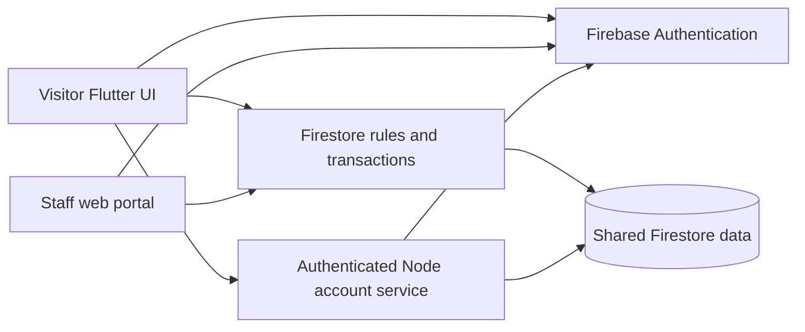

# Member A implementation and results notes

These notes describe the implemented account/ticket/admin contribution. They are
evidence for the report, not a claim that all proposal technologies are complete.
Updated 7 November 2026; validation target: Chrome/web, existing Firebase project.

## Architecture

The Flutter application contains a visitor interface and an administrator web
portal. Firebase Authentication supplies verified user identity. Cloud Firestore
stores visitor profiles, catalog configuration, orders, issued tickets, admission
events, loyalty records, vouchers and support cases. Visitor requests are scoped
to the authenticated UID; administrator permissions use the existing trusted
admin:true custom claim. A separate named Firebase app instance keeps the staff
and visitor sign-in sessions separate while using the same registered project.

UI widgets call feature repositories rather than embedding fixture records.
Transactions couple dependent updates. Separate injectable repository interfaces
allow automated UI checks without editing the shared project's user data.
The normal runtime always connects to themeparksmartmanagement. Isolated local
services are used only by the backend rules checks, independently of the app.

## Authentication and account handling

Registration creates a Firebase Auth account and an owned visitor profile.
Email verification gates access. Failed initial profile setup can be retried
without replacing an existing profile. Login restores the session and respects
the web Remember me selection. Personal information changes are validated and
saved with concurrency checks; email changes require verification of the new
address. Password changes and sensitive actions require reauthentication.

The Node account service verifies ID tokens with revocation checking, derives the
caller UID from authenticated identity and never accepts a caller-supplied owner
for privileged operations. It records application devices, revokes refresh tokens
for sign-out-everywhere and handles resumable deletion. Trusted Firestore security
markers deny private access by old tokens and accounts undergoing deletion.
Current passwords remain within the Firebase client authentication flow.

## Ticket booking and admission

The visitor follows distinct Figma screens for pass selection, pass details,
cart, guest details, review, payment selection, confirmation and digital tickets.
Orders support up to five pass lines and ten named guests with separate adult/
child fares. Dates use Malaysia park dates. Prices and amounts use integer MYR sen.
The agreed checkout records confirmation without a real bank/card charge.

A stable random request ID and input fingerprint provide idempotent retries.
The order, issued tickets, private reference mappings and any points deduction
are committed atomically. Rules validate current catalog fares, allowed dates,
guest counts, ownership and exact amounts. Failed/incomplete issuance cannot
leave partial tickets. The QR contains the opaque ticket document ID with TP1
prefix; lookup and admission are authorised against persisted server state.

Administrator admission validation previews a ticket before committing a daily
admission event. Repeated/concurrent scans do not admit twice. Multi-day and
annual passes retain their remaining valid dates. History and PDF receipts use
the saved order data rather than Figma example values.

## Supporting administration, rewards and help

The web portal provides visitor search/filter/sort/pagination, profile controls,
private metadata and reversible access restrictions. Pass packages can be edited
or deactivated while historical records remain available. Orders, tickets and
admission activity are visible to authorised staff.

Completed purchases earn one point per full RM1 of the net total, once. Voucher
exchange couples the ledger entry, balance debit and voucher issuance. Voucher
use is confirmed once and expiry uses Malaysia dates. Support cases preserve
original submissions and private attachments; public replies, staff-only notes,
status changes, resolution summaries and reopening maintain an audited history.

## Validation results

| Evidence | Result |
|---|---|
| Flutter model/UI/workflow checks | 40 passed |
| Isolated Firestore rule checks | 38 passed |
| Account service checks | 10 passed |
| Scoped Dart analysis | No issues |
| Release web build | Passed |
| Running visitor browser | Existing session/profile, help, account navigation and authenticated device registry verified |

Checks cover ownership, forged prices/roles/balances, partial transaction rollback,
concurrent admission/spending/replies, duplicate retry IDs, voucher expiry/single
use, private notes/attachments, profile bounds, revoked-token access and deletion
retry/privacy. Account-changing operations were checked with isolated fixtures;
the agent did not change live passwords, send reset mail, revoke live sessions,
delete a real account or create a fixture user in the shared project.

User hands-on checks remain documented per module. Joint ticket-to-reservation
acceptance must be executed after Member B supplies the final source.

## Practical limits and remaining integration

Chrome/web is the checked target; native builds and public deployment need their
own configuration and verification. Member A's account service runs alongside the
local web application using existing server-side Firebase CLI access. Hosted
deployment must supply appropriate server credentials and protected origins.

There is no payment processor, native NFC or Apple/Google Wallet pass integration.
The in-app ticket wallet and QR paths work. The face preference does not establish
an OpenCV matching pipeline. Smart photo purchase/editing/kiosk and the proposal's
Situm/landmark/KDE/trained recommendation components are not established by these
modules. A heuristic or a map screen must not be reported as those technologies.
Member B's attraction, slot, reservation, map and recommendation work is integrated
only after receiving and checking that code and any required backend deployment.

Design evidence: docs/design, including original local Figma frame IDs, hashes
and screenshots. Implementation details: docs/handoffs/member-a-module2.md through
member-a-module5.md and the member-a.md integration index.

Firebase references: [user account APIs](https://firebase.google.com/docs/auth/flutter/manage-users)
and [session revocation](https://firebase.google.com/docs/auth/admin/manage-sessions).
